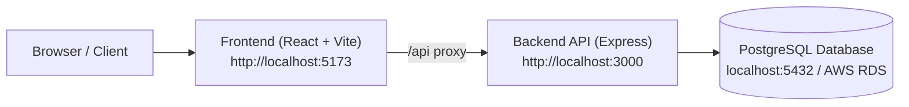

# AWS Three-Tier Task Tracker Application

A modern full-stack task management web application designed with a three-tier architecture: **React (Vite)** on the frontend, **Node.js (Express)** on the backend, and **PostgreSQL** as the database.

---

## 🏗️ Architecture Overview



* **Presentation Tier (Frontend)**: React 18 SPA built with Vite. Proxies API requests to the backend server during local development.
* **Application Tier (Backend)**: RESTful API built with Express.js (ES Modules), with CORS handling, connection pooling, and input validation.
* **Database Tier**: Relational storage using PostgreSQL with connection pooling via `pg`.

---

## 📁 Project Structure

```text
taskapp/
├── backend/
│   ├── src/
│   │   ├── db.js             # PostgreSQL connection pool configuration
│   │   ├── init-db.js        # Script to create the 'tasks' table schema
│   │   └── server.js         # Express server & REST API endpoints
│   ├── .env                  # Environment variables (DB credentials, ports)
│   ├── .env.example          # Sample environment template
│   ├── package.json          # Backend dependencies & scripts
│   └── taskapp.service       # Systemd service configuration for Linux/EC2 deployment
├── frontend/
│   ├── src/
│   │   ├── App.jsx           # Main React component (CRUD & Filter tasks)
│   │   ├── main.jsx          # React DOM entrypoint
│   │   └── style.css         # Custom styling
│   ├── index.html            # HTML shell
│   ├── package.json          # Frontend dependencies & scripts
│   └── vite.config.js        # Vite configuration & API proxy setup
├── .gitignore                # Git ignore rules for dependencies, env, and builds
└── README.md                 # Project documentation
```

---

## ⚙️ Prerequisites

* **Node.js** (v18.x or later recommended)
* **npm** (v9.x or later)
* **PostgreSQL** running locally or an AWS RDS PostgreSQL instance

---

## 🚀 Getting Started (Step-by-Step)

### 1. Database Setup & Environment Variables

1. Ensure PostgreSQL service is running.
2. Create your database and user (if not already created):
   ```sql
   CREATE DATABASE taskapp;
   CREATE USER taskapp_user WITH ENCRYPTED PASSWORD 'your_password';
   GRANT ALL PRIVILEGES ON DATABASE taskapp TO taskapp_user;
   ```
3. Navigate to the `backend/` directory and configure `.env`:
   ```bash
   cd backend
   cp .env.example .env
   ```
4. Update `backend/.env` with your actual database credentials:
   ```env
   PORT=3000
   DB_HOST=localhost
   DB_PORT=5432
   DB_NAME=taskapp
   DB_USER=taskapp_user
   DB_PASSWORD=your_password
   DB_SSL=false
   CORS_ORIGIN=http://localhost:5173
   ```
5. Initialize the database schema (creates the `tasks` table):
   ```bash
   npm run db:init
   ```
   *Expected output: `Database schema ready.`*

---

### 2. Running the Application Locally

Open two terminal windows to run both tiers simultaneously:

#### Terminal 1: Start Backend API
```bash
cd backend
npm install       # If dependencies are not yet installed
npm run dev       # Starts server in watch mode on http://localhost:3000
```
> Or run `npm start` for standard production-mode start.

Test backend health:
```bash
curl http://localhost:3000/health
# Response: {"status":"ok","database":"connected"}
```

#### Terminal 2: Start Frontend Application
```bash
cd frontend
npm install       # If dependencies are not yet installed
npm run dev       # Starts Vite dev server on http://localhost:5173
```

Open your browser and navigate to:
```
http://localhost:5173
```

---

## 📡 API Endpoints

| Method | Endpoint | Description | Request Body |
| :--- | :--- | :--- | :--- |
| `GET` | `/health` | Check API & database health status | None |
| `GET` | `/api/tasks` | Fetch list of all tasks (sorted by newest) | None |
| `POST` | `/api/tasks` | Create a new task | `{ "title": "string" }` |
| `PATCH`| `/api/tasks/:id` | Update task completion status | `{ "completed": boolean }` |
| `DELETE` | `/api/tasks/:id` | Delete a task by ID | None |

---

## 📦 Building for Production

### Frontend Build
To generate production-ready static assets:
```bash
cd frontend
npm run build
```
Static files will be bundled into `frontend/dist/`. You can preview the production bundle with:
```bash
npm run preview
```

### Production Deployment (EC2 / Systemd)
The repository includes a systemd configuration template in [`backend/taskapp.service`](file:///backend/taskapp.service) designed for hosting on Linux EC2 instances.
1. Place the backend directory in `/opt/taskapp/backend`.
2. Copy the service unit to `/etc/systemd/system/taskapp.service`.
3. Enable and start the service:
   ```bash
   sudo systemctl daemon-reload
   sudo systemctl enable --now taskapp
   sudo systemctl status taskapp
   ```
